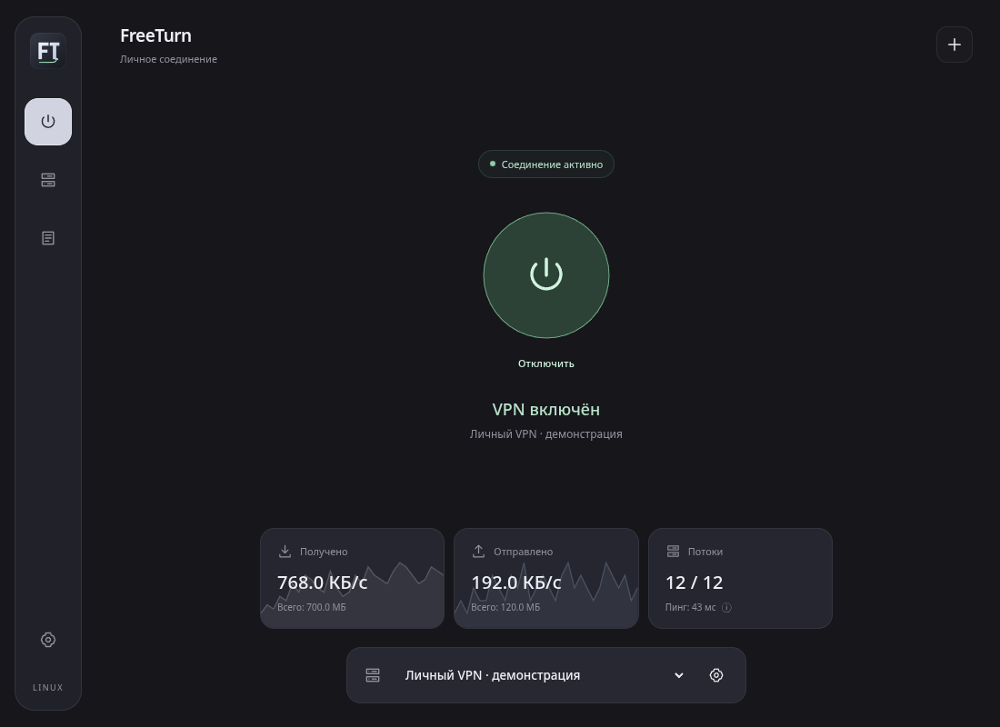
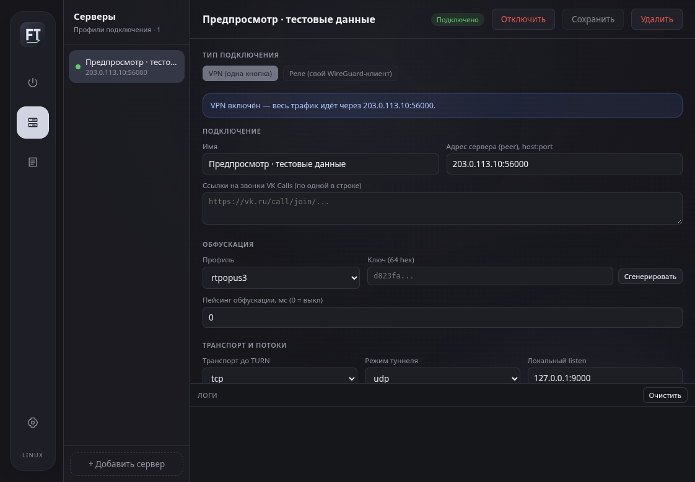
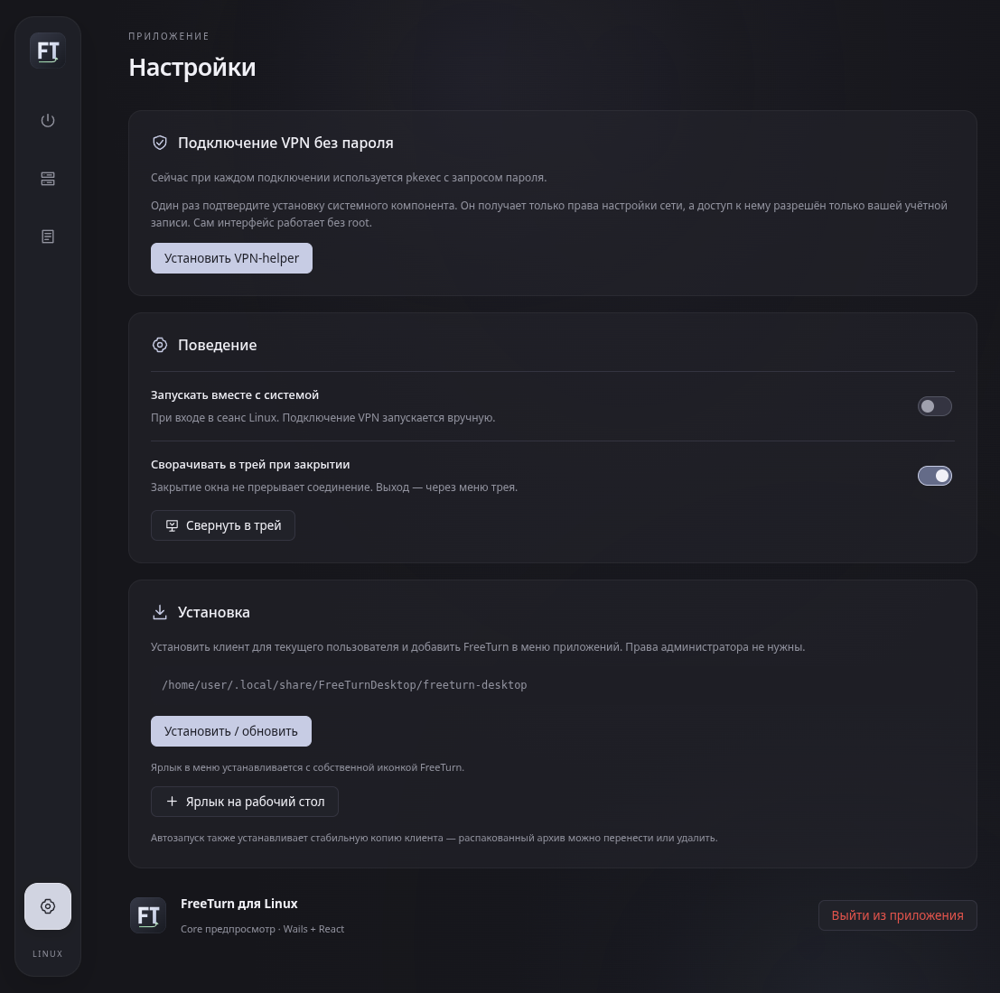

# FreeTurn for Linux

Графический клиент [free-turn-proxy](https://github.com/purkalolka/free-turn-proxy) для Linux на Go, Wails 2 и React. Клиент поддерживает реле для внешнего WireGuard/AmneziaWG и встроенный VPN одной кнопкой.

## Интерфейс

Скриншоты интерфейса на демонстрационных данных. Адрес сервера, скорости и состояние подключения на этих снимках — тестовые, без реального VPN-подключения и пользовательских ключей.

### Подключение и графики трафика



### Профили серверов



<details>
<summary>Настройки: VPN-helper, трей, автозапуск и ярлык</summary>



</details>

## Поддерживаемые системы

- Ubuntu 22.04+ и Debian 12+ с WebKit2GTK 4.1.
- Arch Linux и совместимые дистрибутивы с WebKit2GTK 4.1.

Готовый архив релиза содержит клиент `freeturn-desktop`, системный компонент `freeturn-vpn-helper`, консольные `client` и `server`, а также установщик `install-desktop.sh`. После распаковки запустите `./freeturn-desktop`. Для установки откройте **Настройки → Установить / обновить** или выполните `sh ./install-desktop.sh` (также доступно `./freeturn-desktop --install-desktop`).

Установка не требует `sudo`: стабильная копия клиента помещается в `~/.local/share/FreeTurnDesktop/`, а ярлык — в `~/.local/share/applications/freeturn.desktop`. Учитывается `XDG_DATA_HOME`. Повторная установка обновляет копию клиента. Зависимости GTK/WebKit и инструменты VPN необходимо установить отдельно.

### Автозапуск и автоподключение

В **Настройки → Поведение** независимо включаются **Запускать вместе с системой** (при входе в сеанс Linux) и **Подключаться при запуске**. Для автоподключения выберите сохранённый профиль: приложение делает одну попытку при каждом запуске, включая обычный запуск вручную. По умолчанию автоподключение выключено. Изменение настройки не запускает подключение немедленно.

Для VPN без запроса пароля заранее установите системный VPN-helper. При необходимости капчи потребуется ручной ввод. Если сеть ещё недоступна или профиль удалён, автоматических повторов нет: подключитесь вручную или выберите другой профиль в настройках. Автоподключение не является kill switch и не блокирует трафик до установления VPN.

### Иконка и ярлык на рабочем столе

У клиента собственная иконка FreeTurn: она используется в меню приложений, доке, окне и трее. Установка размещает SVG и PNG в пользовательской теме `~/.local/share/icons/hicolor/` (с учётом `XDG_DATA_HOME`). Запускной файл и GTK используют одинаковый идентификатор `freeturn`, чтобы окно корректно группировалось в доке.

Чтобы добавить ярлык на рабочий стол, откройте **Настройки → Установка → Ярлык на рабочий стол**. Учитывается локализованный `XDG_DESKTOP_DIR` из `user-dirs.dirs`, в том числе «Рабочий стол». Ярлык указывает на установленную копию, а не на временный каталог распакованного архива. Если окружение потребует подтверждения, выберите **Разрешить запуск**. Чужой существующий `freeturn.desktop` не перезаписывается.

Если GNOME не отображает значки рабочего стола, потребуется расширение **Desktop Icons NG (DING)**. Ярлык в меню приложений работает без него.

Альтернатива из каталога приложения (без `sudo`):

```sh
./freeturn-desktop --create-desktop-shortcut
```

Для работы окна нужны GTK3 и WebKit2GTK 4.1. Для уведомлений о капче используется `notify-send` (`libnotify-bin` в Debian/Ubuntu, `libnotify` в Arch).

В режиме VPN нужны `/dev/net/tun`, `ip` из `iproute2`, `pkexec` с работающим Polkit-агентом и `systemd-resolved` для настройки DNS из WireGuard-конфига. Приложение остаётся запущенным от обычного пользователя. По умолчанию каждое подключение запускает отдельный привилегированный процесс через Polkit. Необязательный системный helper позволяет подключаться без повторных запросов пароля — см. ниже.

### Зависимости для запуска

Ubuntu/Debian:

```sh
sudo apt install libgtk-3-0 libwebkit2gtk-4.1-0 iproute2 polkitd systemd-resolved libnotify-bin
```

Arch:

```sh
sudo pacman -S gtk3 webkit2gtk-4.1 iproute2 polkit systemd libnotify
```

Проверьте, что служба `systemd-resolved` работает, если в конфиге WireGuard заданы DNS-серверы. На дистрибутивах с другим DNS-менеджером режим реле работает без этого требования; встроенный VPN сообщит об ошибке настройки DNS и вернёт сетевые маршруты.

## Подключение

1. Добавьте сервер по ссылке `freeturn://` или настройте свой VPS через мастер в приложении.
2. Если у профиля есть WireGuard-конфиг, выберите «VPN (одна кнопка)» и нажмите «Включить VPN». Без установленного системного helper Polkit запросит права на настройку сети.
3. В режиме «Реле» запустите подключение в FreeTurn и направьте внешний WireGuard/AmneziaWG-клиент на указанный локальный порт.

Встроенный VPN запускает реле на обычном интернет-соединении и добавляет маршруты через TUN только после установки соединения. При отключении и при неожиданном завершении приложения привилегированный процесс снимает маршруты и DNS с созданного интерфейса.

### VPN без пароля при каждом подключении

1. Откройте **Настройки → Подключение VPN без пароля → Установить VPN-helper**.
2. Один раз подтвердите установку паролем администратора. Рядом с приложением должен находиться `freeturn-vpn-helper` из того же архива релиза. Обычная пользовательская установка копирует оба файла вместе.
3. Следующие подключения используют системный компонент без `pkexec` и запросов пароля. Установка/обновление самого системного компонента по-прежнему требует подтверждения администратора.

Установка добавляет root-owned `/usr/local/libexec/freeturn-vpn-helper` и пользовательские units `/etc/systemd/system/freeturn-vpn-<UID>.socket` и `freeturn-vpn-<UID>@.service`. Socket activation запускает отдельный процесс на время подключения. Сокет `/run/freeturn-vpn/<UID>.sock` имеет режим `0600`; helper дополнительно проверяет UID клиента через `SO_PEERCRED`. Доступ предоставляется только выбранной учётной записи. Сервис ограничен сетевыми capabilities, не имеет доступа к домашним каталогам и не разрешает запись в системные каталоги. Пароли не сохраняются, GUI не получает root, `sudoers` и правила Polkit не ослабляются.

Режим требует systemd. Если компонент не установлен или его сокет отключён, используется прежний вариант с Polkit. Для отключения режима нажмите **Удалить доступ** — потребуется пароль, активный VPN будет остановлен. Общий root-owned бинарник остаётся на диске для других пользователей; после удаления доступа он больше не предоставляет этой учётной записи беспарольный запуск.

Альтернатива для терминала (из каталога распакованного релиза):

```sh
sudo ./freeturn-desktop --install-vpn-service "$(pwd)/freeturn-vpn-helper" "$(id -u)"
# Отозвать доступ этой учётной записи:
sudo ./freeturn-desktop --remove-vpn-service "$(id -u)"
```

## Трей и автозапуск

- **Настройки → Сворачивать в трей при закрытии**: по умолчанию включено. Закрытие окна скрывает его, не отключая VPN. В меню трея доступны «Открыть FreeTurn» и «Выход». Полный выход отключает VPN и восстанавливает маршруты.
- Трей использует StatusNotifierItem/AppIndicator через пользовательский D-Bus. В GNOME установите расширение **AppIndicator and KStatusNotifierItem Support**. Если трей недоступен, окно не скрывается: закрытие завершает приложение и VPN.
- **Настройки → Запускать вместе с системой**: создаёт `~/.config/autostart/freeturn.desktop` (учитывается `XDG_CONFIG_HOME`) и устанавливает стабильную копию клиента. Это запуск при входе в графический сеанс. Для автоматического подключения отдельно включите **Подключаться при запуске** и выберите профиль. При установленном системном helper подключение не требует пароля.
- При автозапуске окно скрывается, только если трей доступен. Повторный запуск из меню показывает уже работающее окно.
- Для удаления сначала отзовите доступ к системному VPN-helper (если установлен), выключите автозапуск и завершите приложение, затем удалите `~/.local/share/FreeTurnDesktop/` и `~/.local/share/applications/freeturn.desktop`. Профили в `~/.config/FreeTurnDesktop/` сохраняются.

Главный экран содержит кнопку подключения, выбор сервера и текущую скорость трафика. Полупрозрачные графики в карточках приёма и отправки показывают последние 60 замеров, отдельно для каждого направления. Редактирование профилей и управление VPS находятся в разделе **Серверы**, последние 500 записей — в **Журнале**.

## Обновления приложения

В **Настройки → Обновления** можно проверить стабильные релизы и скачать архив для архитектуры текущего клиента. Репозиторий задаётся **при сборке**, а не в исходниках: workflows передают `${{ github.repository }}`, поэтому каждый форк проверяет собственные Releases. Тестовые артефакты Actions и prerelease не предлагаются.

Автопроверка по умолчанию включена: через 10 секунд после запуска, затем каждые 6 часов, пока приложение работает (в том числе в трее). Её можно выключить; ручная проверка остаётся доступной. Передаются только обычные запросы к публичному GitHub API, без VPN-профилей, ключей и токенов пользователя. Недоступность GitHub или ограничение частоты запросов не мешают VPN. При новой версии в интерфейсе появляется уведомление. Его можно закрыть крестиком: эта версия больше не напоминает о себе, в том числе после перезапуска, но остаётся доступной в настройках. Следующая версия или другой репозиторий снова вызывают уведомление.

Скачивание запускается **только по кнопке**, место сохранения выбирается в диалоге. Клиент требует архив `FreeTurn-Linux-<архитектура>-<тег>.tar.gz` и `checksums.txt` из того же релиза. Размер и SHA-256 проверяются до сохранения итогового файла; при ошибке временный файл удаляется. SHA-256 защищает от повреждения скачивания, но не является независимой цифровой подписью издателя.

Кнопка **Скачать и установить** открывает отдельное подтверждение с версией, местом установки и предупреждением об отключении VPN. После согласия клиент скачивает и проверяет архив, безопасно извлекает только два ELF-бинарника нужной архитектуры, завершает VPN и приложение. Отдельный пользовательский процесс ждёт завершения старого клиента, сохраняет предыдущую пару, заменяет файлы в `~/.local/share/FreeTurnDesktop/` (с учётом `XDG_DATA_HOME`), обновляет иконки/ярлык и запускает новую копию. Каждая замена файла атомарная; профили и настройки не меняются. Ни `sudo`, ни права администратора для этого не используются.

Новая копия должна подтвердить запуск интерфейса за 45 секунд. При ошибке установки или запуска восстанавливается предыдущая пара и запускается старый клиент; результат виден в **Настройки → Обновления**. Резервная копия лежит в `.freeturn-update-*/previous/` внутри каталога установки; точный путь показан в настройках. Эти каталоги не удаляются автоматически. Для ручного отката после успешной установки завершите клиент, запустите `freeturn-desktop` из указанной резервной папки и выберите **Установить / обновить**. Логи процесса установки хранятся в той же `.freeturn-update-*` папке. Защита от внезапного отключения питания между заменой двух файлов не гарантируется.

**Системный** `/usr/local/libexec/freeturn-vpn-helper` не заменяется автоматически: после перезапуска используйте отдельную кнопку обновления VPN-helper с подтверждением администратора. Автопроверка по-прежнему ничего не скачивает и не устанавливает без согласия. Старая версия без протокола подтверждения запуска не устанавливается автоматически: для неё можно воспользоваться отдельной кнопкой **Скачать**, распаковать архив и установить вручную. Релизы без готового архива или SHA-256 скачать через клиент нельзя.

Версия GUI встраивается в релизную сборку из тега независимо от версии VPN-ядра. У локальных/тестовых сборок без тега показано `dev`: точное сравнение версий невозможно, но стабильный релиз можно скачать. Для локальной сборки явно укажите источник и, при необходимости, версию:

```sh
UPDATE_REPOSITORY=owner/repository VERSION=v2.1.0 sh packaging/linux/build-desktop.sh
```

Без `UPDATE_REPOSITORY` локальная сборка не обращается к серверу обновлений. Для ручного `wails build` эквивалент — добавить `-X main.updateRepository=owner/repository -X main.desktopVersion=v2.1.0` к `-ldflags`.

## Сборка

### Автосборка в GitHub

Workflow **Build Linux desktop** запускается после каждого push в ветку, для pull request или вручную через **Actions → Build Linux desktop → Run workflow**. Он собирает Linux amd64, выполняет проверки и сохраняет результат на 14 дней: откройте успешный запуск → **Artifacts → FreeTurn-Linux-amd64**. Внутри — архив `FreeTurn-Linux-amd64.tar.gz` и файл SHA-256. Архив содержит приложение, VPN-helper, установщик, ярлык, иконку и документацию; консольные `client` и `server` остаются в полном релизе.

Это тестовые сборки текущей ветки, не автоматическая публикация релиза. Релизный workflow по тегам `v*.*.*` сохранён отдельно. В форке при необходимости включите GitHub Actions во вкладке **Actions**.

### Одной командой локально

```sh
sh packaging/linux/build-desktop.sh
```

Скрипт проверяет инструменты и GTK/WebKit, устанавливает Wails CLI закреплённой версии, выполняет `npm ci`, собирает приложение с helper и создаёт архив в `dist/` с SHA-256. Запускается из любого каталога, без `sudo`; системные зависимости нужно установить заранее. Исходные профили и установленная копия приложения не меняются.

### Зависимости и ручная сборка

Требуются Go 1.26+, Node.js 22.18+, npm, C-компилятор, заголовки GTK3 и WebKit2GTK 4.1. На Ubuntu/Debian установите `libgtk-3-dev libwebkit2gtk-4.1-dev`; на Arch используйте `gtk3 webkit2gtk-4.1 base-devel`.

```sh
go install github.com/wailsapp/wails/v2/cmd/wails@v2.16.0
npm --prefix desktop/frontend ci
cd desktop
wails build -tags webkit2_41 -ldflags "-checklinkname=0 -s -w" -trimpath
```

В `desktop/build/bin/` появятся **оба** файла: `freeturn-desktop` и `freeturn-vpn-helper`. Helper автоматически собирается Linux post-build hook после сборки приложения, для той же архитектуры. Переносите оба файла вместе; после сборки запускайте новую копию и используйте **Настройки → Установить / обновить**, чтобы обновить ранее установленный клиент вместе с helper. Для разработки используйте `wails dev -tags webkit2_41`. Команда `task build` собирает только консольные `client` и `server` в `dist/`.

Если приложение уже собрано, недостающий helper можно собрать отдельно из корня репозитория:

```sh
sh packaging/linux/build-vpn-helper.sh
```

Проверки обновления состояния и статистики интерфейса: `npm --prefix desktop/frontend test`.

Исходник иконки — `desktop/assets/icon.svg`; PNG-версии и favicon уже включены в репозиторий. После изменения SVG их можно обновить командой `sh packaging/linux/render-icons.sh` (нужен `rsvg-convert` из `librsvg2-bin` / `librsvg`).

Go-модуль намеренно сохраняет имя `github.com/samosvalishe/free-turn-proxy`, чтобы не менять импорты ядра и существующие инструменты. Источник Linux-клиента отделён от [Windows-клиента](https://github.com/purkalolka/free-turn-windows); серверная часть и протокол совместимы.
